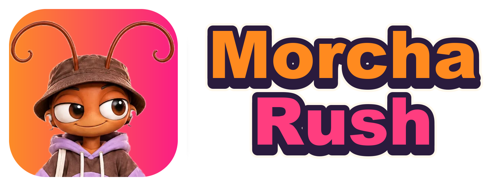
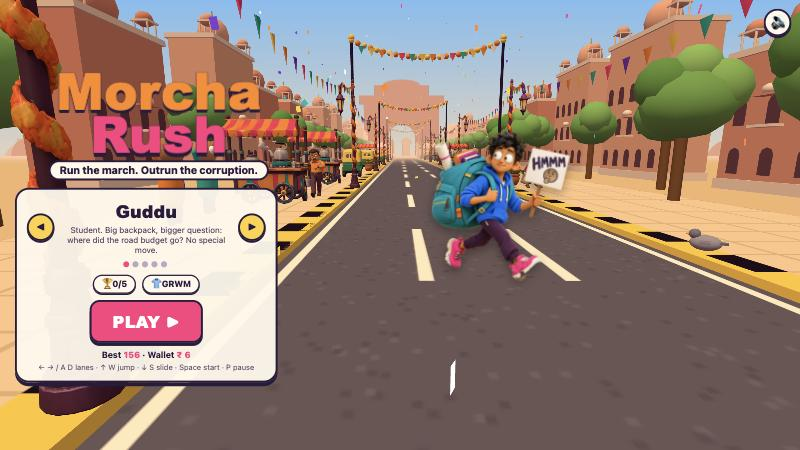
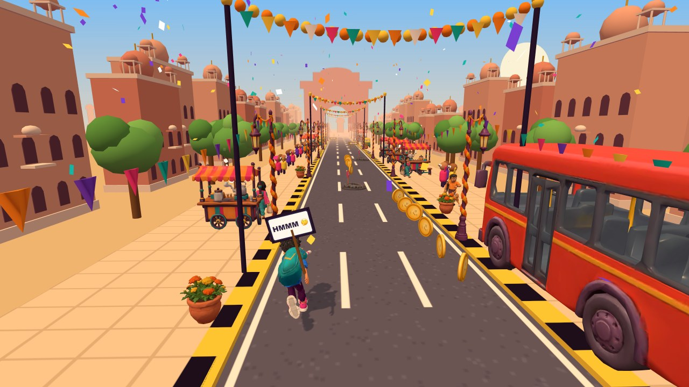
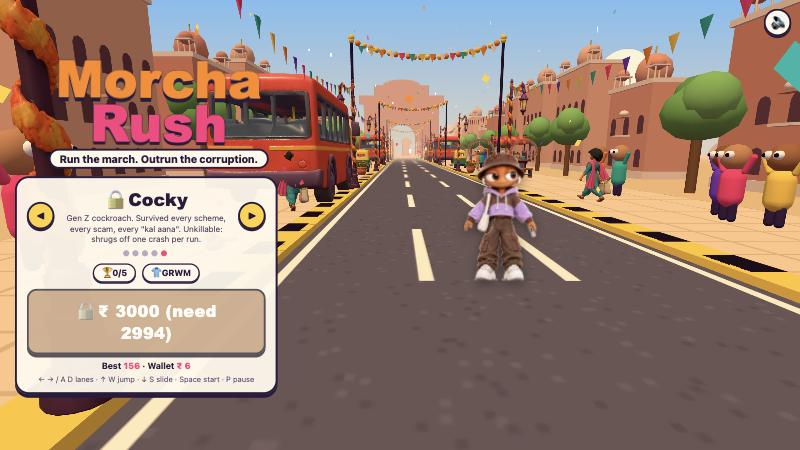
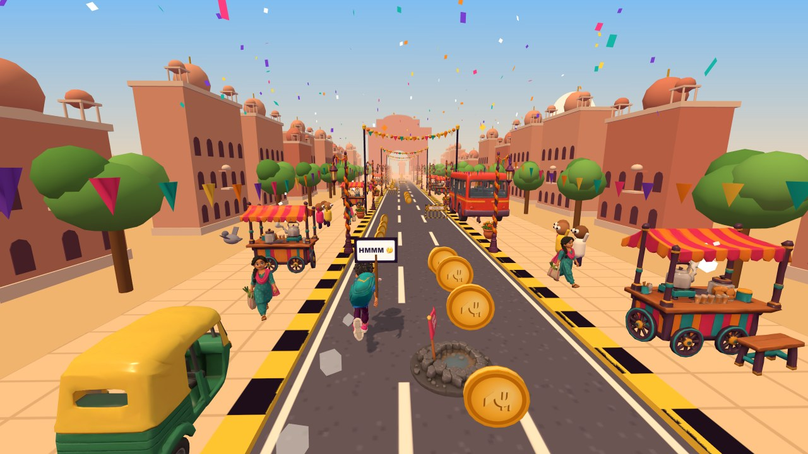
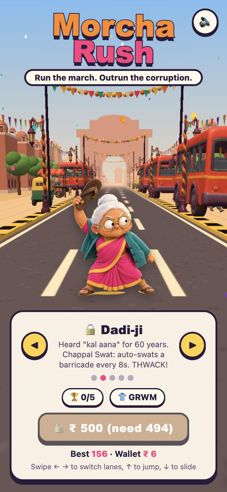

<p align="center">
  
</p>

<p align="center">
  <b>Run the march. Outrun the corruption.</b><br>
  A satirical 3D endless runner through a festive Indian street, with a bribe-hungry Inspector on your heels.
</p>

<p align="center">
  <a href="https://morcha-rush.vercel.app"><b>▶ Play now: morcha-rush.vercel.app</b></a>
</p>

<p align="center">
  
  
</p>

## About

Morcha Rush is a lane-switching endless runner in the spirit of Subway Surfers, set at a street march (*morcha*). You ring a gate's doorbell, shout "BHAAG!" and run. Dodge barricades, Section 144 signs, potholes and VIP convoys. Grab coins and power-ups. Stumble twice before you recover and the Inspector catches you and demands his *chai-paani*.

The humour pokes at everyday red tape and petty corruption, never at real people or parties.

It runs in the browser on desktop and mobile, with no install and no build step.

## Characters

| | Character | Ability | Unlock |
|---|---|---|---|
| 🎒 | **Guddu** | A student with a big backpack and a bigger question: where did the road budget go? No special move. | Free |
| 🩴 | **Dadi-ji** | **Chappal Swat:** automatically swats a barricade out of the way every 8 seconds. | ₹500 |
| 🥁 | **Dhol Bro** | **Beat Drop:** every landing sends a shockwave that clears obstacles ahead. | ₹1000 |
| 📸 | **Camera Intern** | **Viral Flash:** every near-miss flashes the camera for +25 points. | ₹2000 |
| 🪳 | **Cocky** | **Unkillable:** a Gen Z cockroach who shrugs off one crash per run. | ₹3000 |

<p align="center">
  
  
</p>

## Power-ups

| | Power-up | Effect |
|---|---|---|
| ☕ | Cutting Chai | A speed burst that smashes through anything in your way |
| 🥁 | Dhol Beat | Smashes barricades |
| 📸 | Press Pass | Invincible for a few seconds. "EXPOSED!" |
| 🛺 | Jugaad Thela | Ride a cart that absorbs one crash |
| 🍽️ | Steel Thali | A clatter that stuns the Inspector |

There are also random **Bijli Gayi** power cuts, onion carts that make you cry, achievements, Guddu outfits (GRWM), and a little brown visitor worth catching.

## Controls

| | Desktop | Mobile |
|---|---|---|
| Switch lanes | ← → or A D | Swipe left / right |
| Jump | ↑ or W | Swipe up |
| Slide | ↓ or S | Swipe down |
| Start / pause | Space / P | Tap |

<p align="center">
  
</p>

On a phone you can add it to your home screen and it opens full-screen like an app.

## Run it locally

No install is needed. Serve the folder with any static server:

```bash
python3 -m http.server 8765
```

Then open http://localhost:8765. Opening `index.html` directly from disk also works, because the 3D models are packed into `models.js`.

## How it's built

- **One HTML file:** [`index.html`](index.html) holds all the game code, using [Three.js](https://threejs.org) r160 loaded from a CDN. There's no framework and no bundler.
- **3D models:** the characters, obstacles, power-ups and street props in [`models/`](models) are rigged GLB files generated with Higgsfield (Meshy and Tripo) from the concept art in [`concepts/`](concepts). [`tools/optimize-models.sh`](tools/optimize-models.sh) meshopt-compresses them into `models-web/` (11 MB → 5 MB), which the website loads in parallel and caches. [`tools/pack-models.py`](tools/pack-models.py) also packs them into `models.js` as base64, used only when `index.html` is opened straight from disk. Re-run both after changing a model:
  ```bash
  tools/optimize-models.sh && python3 tools/pack-models.py
  ```
- **Menu art:** the start screen shows each character's concept art as a cutout (in [`art/`](art)). The 3D model takes over when the run starts.
- **Fallbacks:** if a model fails to load, the game builds that character from simple shapes instead.
- **Saves:** your progress is saved in the browser with `localStorage`.

## Project layout

```
index.html              the whole game
models-web/             compressed GLB models the website loads (generated)
models-list.js          model names (generated)
models.js               base64 models for file:// (generated)
models/                 source GLB models + notes
art/                    menu cutouts of each character
brand/                  logo and app icons
concepts/               concept art and turnaround sheets
screenshots/            README images
tools/                  model compression + packing scripts
design-doc.html         game design document
```

## Deploy

The game is a static site and is deployed on [Vercel](https://vercel.com). `.vercelignore` keeps the concept art and source models out of the upload.

```bash
vercel --prod
```
